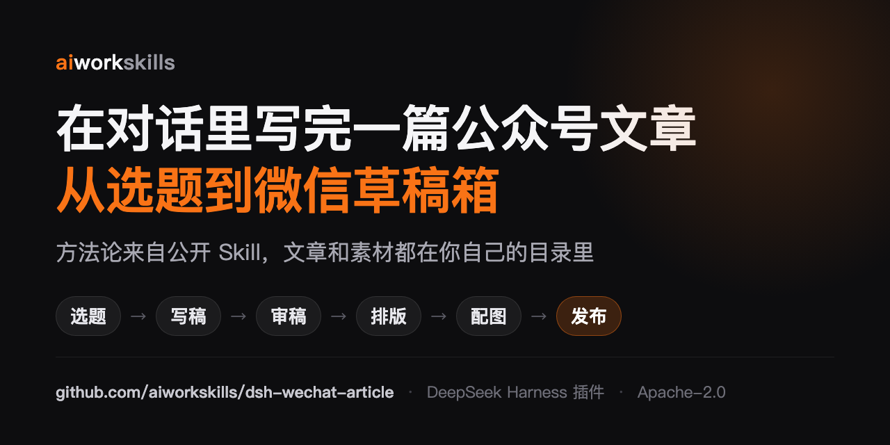

# aws-wechat-article

**在对话里写完一篇公众号文章 —— 从选题一路到微信草稿箱。**

给 [DeepSeek Harness](https://github.com/deepseek-ai/DeepSeek-Harness) 装上这个插件，
然后像平时说话一样开口：

```text
写一篇介绍 DeepSeek Harness 插件体系的公众号文章，面向有 TypeScript
经验的开发者。先给我几个选题方向，确认后再继续写。
```

它会依次完成**选题、写稿、审稿、排版、配图、发布**，把定稿、HTML 和图片留在你自己的
项目目录里，需要你拍板的地方停下来问你。


> 社区预览版，适配 DeepSeek Harness `0.1.1-rc.2`。

## 凭什么不是「再套一层提示词」

**方法论是公开的，而且不在这个插件里。**
怎么选题、怎么审稿、排版长什么样，全部由
[wechat-article-skills](https://github.com/aiworkskills/wechat-article-skills)
这个独立仓库决定 —— 9 个 Skill，你能读它、改它、也能在别的支持 Skills 的工具里用它。
插件只负责接线，不重新发明一套写法，更不会把方法藏进自己的代码里。

**素材是长期资产，不是每次重贴。**
产品资料、案例、配图按内容方向存在项目里，写文章时说一句「用公众号 Skills 这个方向」，
智能体自己去取，并优先从对应图片里挑正文配图。

**终点是草稿箱，不是聊天框。**
排版 HTML、封面、正文配图都会生成好，配置了公众号凭据之后直接进微信草稿箱 ——
不需要你把内容从对话里一段段搬出去。

**东西都在你自己的目录里。**
文章、配置、素材全部落在当前项目下，插件不建立另一份云端资料库。

## 怎么安装

当前版本需要从源码安装。安装前请准备：

- DeepSeek Harness `0.1.1-rc.2`
- Node.js `22.19`，或者 Node.js 24 及更高版本
- pnpm 11
- git

由于 DeepSeek Harness 仍处于 RC 阶段，本插件目前和 Harness 源码一起安装。在 macOS 或 Linux 终端中复制并执行下面的完整命令：

```bash
set -e

mkdir -p "$HOME/code/aiworkskills"

if [ ! -d "$HOME/code/deepseek-harness/.git" ]; then
  git clone https://github.com/deepseek-ai/DeepSeek-Harness.git \
    "$HOME/code/deepseek-harness"
fi

if [ ! -d "$HOME/code/aiworkskills/dsh-plugin/.git" ]; then
  git clone https://github.com/aiworkskills/dsh-wechat-article.git \
    "$HOME/code/aiworkskills/dsh-plugin"
fi

cd "$HOME/code/deepseek-harness"
pnpm install
pnpm run build

cd "$HOME/code/aiworkskills/dsh-plugin"
pnpm install
pnpm build

cd "$HOME/code/deepseek-harness"
pnpm dsh plugin --profile web add "$HOME/code/aiworkskills/dsh-plugin"
pnpm dsh web --port 3081
```

打开 `http://127.0.0.1:3081/`。安装成功后，左侧栏底部会出现“公众号”，插件管理页中只会显示一个插件：`aws-wechat-article`。

## 怎么使用

### 1. 打开一个公众号项目

在 DeepSeek Harness 中新建或打开一个会话，并选择一个本地文件夹作为工作区。这个文件夹将保存该项目的公众号配置、写作素材和文章文件。

点击左侧栏底部的“公众号”，右侧会打开公众号工作台。

### 2. 安装公众号写作 Skill

第一次打开时，点击“安装公众号写作 Skill”。

> 配置了 [`skillSourceDir`](#使用预置的-skill-检出) 的部署不会看到这一步：Skill 已经就位，
> 右上角直接显示“更新 Skill”。

插件会从 GitHub 安装 [aiworkskills/wechat-article-skills](https://github.com/aiworkskills/wechat-article-skills)。安装只需要完成一次，以后右上角会显示“更新 Skill”。


Skill 没有打包在插件源码里。这样插件和 Skill 可以分别更新，你使用的也始终是公开仓库中的原版 Skill。

### 3. 完成公众号配置

安装 Skill 后，按照页面依次完成下面的公众号配置。

首先填写公众号定位、目标读者和默认作者，让智能体知道这个账号是谁、写给谁看。


然后选择内容策略，确定常写的文章类型、标题方向和内容结构。


接着填写写作规范，让生成的文章符合账号自己的语言习惯和内容要求。


选择排版、封面和正文配图风格，确定文章最终的视觉效果。


最后根据需要配置微信公众号发布信息。完成后，文章可以直接进入微信草稿箱或继续执行发布流程。


点击“保存并应用配置”后，配置会应用到当前项目。

以后需要调整时，可以点击右上角“技能配置”。悬停该按钮还可以选择在线配置、打开独立配置网站，或者直接打开本地配置文件夹。

### 4. 在对话中写文章

配置完成后，直接在主对话告诉智能体你想写什么，不需要在右侧工作台中点击“开始新文章”。

例如：

```text
写一篇介绍 DeepSeek Harness 插件体系的公众号文章，面向有 TypeScript
经验的开发者。先给我几个选题方向，确认后再继续写。
```

智能体会按照公众号 Skill 的流程推进，并在需要你做决定时停下来确认。中途退出后，也可以让它读取已有文章文件并继续处理。

### 5. 查看和修改文章文件

右侧“创作”页面按最近更新时间显示每篇文章。展开文章后，可以看到：

- Markdown 定稿或草稿
- HTML 排版文件
- 封面图片
- 正文配图

点击文件可以预览。点击文件右侧的引用按钮，可以把这份稿件或某一张图片放进主对话，然后针对它提出修改要求。


例如，引用一张正文配图后直接说：

```text
重新生成这张图片，保持原来的内容，但改成更简洁的科技媒体风格。
```

### 6. 管理写作素材

“写作素材”用于保存长期可复用的产品介绍、业务资料、案例和图片。

你可以创建多个内容方向，例如“公众号 Skills”“DeepSeek Harness”或某个具体产品。每个内容方向下面都可以上传文档和图片，也支持拖入文件、批量导入、预览、重命名和删除。


写文章时，只要告诉智能体使用哪个内容方向，它就会按照 Skill 的规则读取相关资料，并优先从对应图片中选择正文配图。

## 给部署方

把它接进托管服务、换自己的配置站、锁定 Skill 版本、改工作台的叫法、调缩略图缓存 ——
都在 **[部署与配置](docs/deployment.md)**。本机自己用不需要看那一页。

## 与开源生态的关系

这个项目由四个部分共同组成：

### DeepSeek Harness

[DeepSeek Harness](https://github.com/deepseek-ai/DeepSeek-Harness) 提供对话、智能体执行、工具调用、文件操作和插件系统。`aws-wechat-article` 作为一个独立插件安装到 Harness，不需要修改 Harness 源码。

### aws-wechat-article 插件

本仓库负责把公众号能力接入 Harness，包括：

- 左侧“公众号”入口和右侧工作台
- Skill 的安装与更新
- 配置页面接入和配置状态检查
- 文章文件的浏览、预览和引用
- 写作素材的上传与管理
- 产品资料和图片能力与智能体的连接

插件只负责连接和使用体验，不重新定义公众号写作流程。

### wechat-article-skills

[aiworkskills/wechat-article-skills](https://github.com/aiworkskills/wechat-article-skills) 是公众号创作能力的核心，定义了从选题到发布的完整方法、规则和脚本。

Skill 通过 GitHub 单独安装，插件不会复制、修改或内置它的源码。用户可以独立更新 Skill，也可以在其他支持 Skills 的智能体工具中使用它。

### aiworkskills.cn 配置工具

[aiworkskills.cn/config](https://aiworkskills.cn/config) 用于生成和维护公众号 Skill 的配置。插件直接接入已经部署的配置网站，不在插件中复制一份配置系统。

这种分工让每一部分都可以独立演进：

```text
DeepSeek Harness
    └── aws-wechat-article 插件
            ├── 安装并调用 wechat-article-skills
            ├── 接入 aiworkskills.cn/config
            └── 读取当前项目的文章与写作素材
```

文章、配置和写作素材都保存在用户自己的项目目录中，插件不建立另一份云端资料库。

本插件和上游 Skill 均采用 [Apache License 2.0](LICENSE)。

- 使用讨论：[GitHub Discussions](https://github.com/aiworkskills/dsh-wechat-article/discussions)
- 缺陷与建议：[GitHub Issues](https://github.com/aiworkskills/dsh-wechat-article/issues)
- 安全问题：请通过仓库 Security 页面私下报告，不要创建公开 Issue
